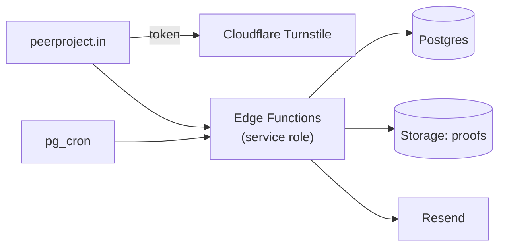
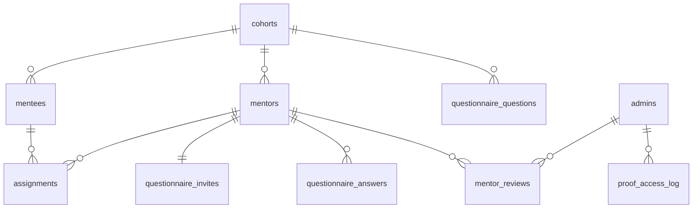

# The Peer Project // Backend


> free / student-run / non-profit in collaboration of r/CBSE, r/ICSE, and r/JEE

> https://peerproject.in

Application portal for The Peer Project. Includes the mentee form, mentor form, mentor questionnaire, admin panel and matching script.

## Stack

- Supabase for the db, storage, auth, Edge Functions (JavaScript on Deno), `pg_cron`, `pg_net`
- Bot-checks - Cloudflare Turnstile
- Email - Resend
- Python for matching (`nvidia/llama-nemotron-embed-1b-v2`, `google/gemma-3-4b-it`, on an NVIDIA GPU)

## Architecture



## Schema



Also: `help_area_options`, `mentee_help_areas`, `mentor_help_areas`, `mentee_embeddings`, `mentor_embeddings`, `login_attempts`, `alert_log`.

## Layout

```
supabase/
  migrations/      schema, seed data, scheduled jobs, database functions
  functions/
    _shared/       routing, database client, email, Turnstile, tokens
    apply/         form options, application submission
    questionnaire/ mentor questionnaire by invite token
    admin/         admin API, sign-in, lockout
    purge-proofs/  deletes proofs older than 30 days
  config.toml
matching/          embeddings and mentor suggestions
```

## Security

- RLS enabled on all tables, no policies. `anon` and `authenticated` have no grants. Only the service role (Edge Functions) reads or writes.
- Proofs: private bucket, random filenames, content type set from magic bytes. Opened only by `admin` role via 60-second signed URLs; each open logged to `proof_access_log`. Deleted on accept, reject or withdraw; daily job deletes any older than 30 days.
- Questionnaire tokens: 32 random bytes, sent in the URL fragment, stored as SHA-256 hashes.
- Admin sign-in: proxied through `/admin/login`. 3 failures per email in 1 hour locks it for 1 hour and emails admins. Supabase Auth CAPTCHA enabled. An access token hook rejects locked accounts.
- Retention: daily job deletes a cohort's applications 3 months after its `ends_at`.

## Scheduled jobs

| Job | Time (UTC) | Action |
| --- | --- | --- |
| `purge-expired-proofs` | 20:30 | calls `purge-proofs` |
| `purge-expired-cohorts` | 20:45 | runs `purge_expired_cohorts()` |

## API

Errors: `{ "error": "<code>" }` with matching HTTP status.

**apply** (Turnstile-required)
- `GET /apply`: current cohort, open state per form, help-area options.
- `POST /apply/mentee`, `POST /apply/mentor`: `multipart/form-data` with `application` (JSON), `cf-turnstile-response`, and `proof` for mentors (PDF, PNG, JPEG, max 5 MB). Mentor response includes `questionnaire_token`.

**questionnaire**
- `GET /questionnaire`, header `x-questionnaire-token`: questions.
- `POST /questionnaire`, `{ token, answers: [{ question_id, answer }] }`: submit.
- `POST /questionnaire/email`, `{ token }`: email link, max 3.
- `POST /questionnaire/recover`, `{ email, cf-turnstile-response }`: reissue link. Same response whether or not an open questionnaire exists.

**admin** (all except `/login` require `authorization: Bearer <access token>`)
- `POST /admin/login`, `{ email, password, captcha }`
- `GET /me`, `GET /cohorts`, `PATCH /cohorts/:id`
- `GET /mentees`, `GET /mentors` (query: `cohort_id`, `status`), `GET /mentees/:id`, `GET /mentors/:id`
- `POST /:kind/:id/verified`, `{ is_verified }`
- `POST /:kind/:id/status`, `{ status }`: sends decision email on accept, reject, waitlist; deletes mentor proof on accept, reject, withdraw.
- `GET /mentors/:id/proof`, `PUT /mentors/:id/review`
- `GET /assignments`, `POST /assignments`, `PATCH /assignments/:id`

Roles: `reviewer` can read and review; `admin` required for proofs, decisions, verification, assignments and cohort dates.

## Setup

Edge Function secrets (Dashboard → Edge Functions → Secrets):

| Name                | Value                                          |
| ------------------- | ---------------------------------------------- |
| `ALLOWED_ORIGINS`   | `https://peerproject.in`                       |
| `TURNSTILE_SECRET`  | Turnstile secret key                           |
| `RESEND_API_KEY`    | Resend API key                                 |
| `MAIL_FROM`         | `The Peer Project <summons@peerproject.in>`    |
| `QUESTIONNAIRE_URL` | `https://peerproject.in/questionnaire`         |
| `PURGE_SECRET`      | random string, also in Vault as `purge_secret` |
| `DISCORD_INVITE`    | server invite for the mentee acceptance email  |

Vault secrets (Database → Vault): `purge_secret` (same value as `PURGE_SECRET`) and `project_url` (`https://<project-ref>.supabase.co`), both read by the proof purge schedule.

Deploy:

```bash
supabase link --project-ref <project-ref>
supabase db push
supabase functions deploy
```

Add `--use-api` to `functions deploy` if Docker isn't running.

Admins: create the user under Authentication → Users, then insert a row into `admins` (`user_id`, `display_name`, `email`, `role`). Disable public sign-ups. Enable CAPTCHA under Attack Protection. Set `custom_access_token_hook` as the access token hook.

## Matching

```bash
cd matching
python -m venv .venv
.venv/bin/pip install -r requirements.txt
cp .env.example .env
.venv/bin/python match.py --cohort <cohort-id> --dry-run
```

`matching/.env` needs `SUPABASE_URL` and `SUPABASE_KEY` (secret key). Embeds accepted, verified applicants, retrieves nearest mentors with free capacity for the mentee's class, picks one with Gemma, writes a `pending` assignment. `--dry-run` prints without writing.

## Authors
\- Shiven Sharma (ShyZen15), Co-Founder @ The Peer Project
\- niel / https://github.com/nielandvoid, Founder @ The Peer Project

## Copyright
© 2026 peerproject.in. all rights reserved.
